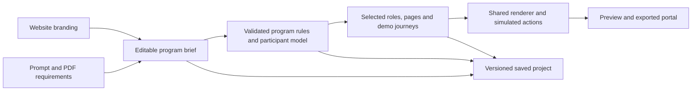

# Requirements-driven B2C and B2B Loyalty Portal Generator

Design proposal · October 18, 2026

Update: the initial requirements/B2C/B2B implementation and Classic/Modern Brand
template selection are complete locally. See `HANDOFF.md` and `PROGRESS.md` for
implemented scope, verification and remaining limitations. Deployment approved.

## Recommendation

Extend LPG from a brand-driven dashboard generator into a requirements-driven portal prototype builder. Keep the quick website-only path. Add a program brief, optional document input, an editable interpretation of the requirements, and B2C/B2B participant models. Use UPG's objective, brief, role-view, and targeted regeneration patterns, with one shared loyalty program definition across all views.

The primary deliverable remains a realistic, interactive prototype. Selected actions should work with consistent demo data. Salesforce integration, actual points posting, organizational authorization, payments, and sending referrals are separate implementation work.

## What the current code supports

| Area | Current evidence | Implication |
|---|---|---|
| LPG input | `index.html:255`, `js/app.js:213`: website URL starts analysis | Brief-only generation and PDF input need new controls and orchestration. |
| LPG AI contract | `js/pagehost.js:301`: fixed consumer schema with prescribed card counts; `js/localai.js:464` and `:554`: multiple AI paths | Introduce a shared requirements-aware contract across every provider path. |
| LPG state application | `js/app.js:274`: whitelisted fields, maximum three tiers | A larger prompt alone cannot introduce organization accounts, dual currencies, or new workflows. |
| LPG output | `js/generator.js:85`, `:119`, `:577`: single dashboard, placeholder navigation, limited interactions | Add supported pages and a small reusable interaction runtime. |
| LPG saved projects | `js/projects.js:77`, `:94`: full-state JSON, legacy defaults, 19 MB client payload limit | Extend existing project storage with versioned fields and explicit migrations. |
| UPG strategy | `../unified-profile-generator/index.html:398`, `:415`; `js/app.js:746` | Reuse B2C/B2B choice, role selection, objective, and freeform brief. |
| UPG role views | `../unified-profile-generator/js/app.js:353`, `:387` | Shared identity with editable role-specific views is a useful pattern. |
| UPG validation/regeneration | `../unified-profile-generator/js/profile-contract.js:20`, `js/app.js:2628` | Validate structured output and prevent late AI responses overwriting current edits. |

UPG currently accepts a text brief and image uploads; it does not provide PDF requirements ingestion. Its role views are presentation variants. LPG needs its own loyalty rules and demo workflows.

## Proposed authoring experience

1. **Describe the program.** Choose B2C or B2B. Enter an optional website, a prompt, a demo objective, and optionally one or more requirements PDFs. Existing website-only generation remains available.
2. **Review the interpretation.** Display editable summaries of audiences, point currencies, tiers, earning/redemption rules, launch scope, proposed pages, and open questions. Link document-derived facts to their source page. Distinguish stated requirements, suggested defaults, and unresolved choices.
3. **Choose people and journeys.** Suggest a few relevant views and let the author rename, remove, or add a custom role. Select the stories the prototype should demonstrate, such as earning status, applying points to a renewal, or requesting a business redemption.
4. **Generate and refine.** Generate the selected modules with coherent sample records. Allow instructions such as “make this view focus on upcoming renewals” or “add a finance approver.” Show the proposed scope of an update and preserve other edits.
5. **Save and present.** Save the brief, extracted requirements, choices, model, views, and demo data with the existing project. Preview role/account changes and export the same supported interactions.

Example brief:

> Create a B2C member loyalty portal for ISACA using the attached requirements. Focus on the initial pilot. Show separate Tier Points and Redeemable Points, progress toward the next tier, and how learning activities contribute. Demonstrate an existing Silver member's transition into Advantage. Keep referrals and partner rewards out of the launch experience. Flag unspecified rules for review.

Long documents should be extracted by page, reduced into structured requirements, and reviewed before generation. A short paragraph should work through the same model with fewer fields. Sparse inputs can use clearly identified demo assumptions rather than require a long questionnaire.

## What the attached ISACA document should produce

Source: `/Users/imansur/Downloads/Loyalty_Referrals.pdf`, 22 pages. The content describes an individual member/customer program; it does not establish an organizational B2B program.

| Source requirement | Prototype representation |
|---|---|
| Separate qualifying Tier Points and non-qualifying Redeemable Points (p. 14) | Two labeled balances. TP drives status; RP is spendable. Redeeming RP does not reduce TP. |
| Core 0–749 TP; Advantage 750–1,999; Premier 2,000+ (p. 14) | Three exact tiers and progress calculated from the qualifying balance. |
| 1 TP per eligible dollar; RP multipliers of 1.0/1.5/2.0; 100 RP = $1 (p. 14) | Rule-based earning examples and invoice-credit redemption value. Multipliers apply to RP only. |
| Calendar-year qualification; RP rounded per earn transaction (p. 14) | Qualification-period label, consistent rounding, and rules explanation. Do not invent an RP expiry policy. |
| Membership, exam registration, study materials as paid pilot earn activities (pp. 15–17) | Relevant earning cards and a transaction history tied to those activities. |
| Webinar attendance 25 TP; white-paper download 10 TP; combined free-content cap of 100 TP/month (p. 16) | Learning actions and progress toward the monthly earning cap, with no RP for these free activities. |
| Tenure-based starting tiers and one-time TP grants (pp. 18–19) | Transition message and a separate launch-grant ledger entry; no RP awarded for tenure. |
| Referrals in expansion wave 1; partner rewards later (p. 13) | Disabled future-scope modules by default, available for an explicitly selected future-state demo. |

A useful demo scenario uses the document's proposed Silver-member starting balance of 1,000 TP. An Advantage member buys the $109 study manual, attends a webinar, and downloads a white paper. Assuming no other events and that the free-content cap is not reached, the result is 1,144 TP and 164 newly earned RP, worth $1.64. The member needs 856 more TP for Premier. This is synthetic demo activity using the document's rules, not actual customer data.

The extraction review should surface these open points:

- Platinum is described as receiving an additional TP cushion, but its proposed grant is the same 2,000 TP as Gold.
- The document mentions a one-time joining bonus; clarify whether it is separate from the tenure transition grant and what new customers receive.
- The tenure ranges overlap at year 3; precise anniversary boundaries need clarification.
- The paid non-member treatment of webinar/download activities needs confirmation before generating those scenarios.
- RP expiry, redemption minimums/limits, post-reset status retention, and multiplier treatment for a transaction that crosses a tier threshold are not fully specified.

Keep steering committees, implementation plans, financial projections, and other internal planning content as context. They should not automatically become member-facing navigation or rewards.

## B2B as a distinct participant model

Separate three entities: **program provider**, **member business**, and **person acting for that business**. A distributor's loyalty portal, for example, belongs to its buying organization; the distributor is not the sample member account.

| Dimension | B2C default | B2B default |
|---|---|---|
| Membership owner | Individual | Business account |
| Points and status | Individual balances/tier | Account balances/tier |
| Typical activity | Purchases, engagement, referrals | Eligible orders, training, participation, referrals as specified |
| Views | Member; optional distinct customer scenarios | Account administrator, purchasing user, rewards approver, with custom roles |
| Redemption | Member redeems | Direct redemption or request/approve, according to the brief |
| Context | Personal account | Selected business; optional branches or business units |

Account administrator can see account progress and team participation; purchasing user can see eligible activity and request a reward; approver can see requests and modeled credit history. These are initial role templates, not requirements imposed on every customer. Branch hierarchy, pooled balances, individual incentives, rebates, and approvals must be selectable, because B2B programs differ.

Keep roles separate from personas: a new member versus a long-tenured member is a scenario, whereas requester versus approver changes permitted demo actions. Role switching must keep shared balances and transactions coherent.

The author signs into LPG through the existing SaaSy OTP mechanism. A prototype role switcher changes the demonstrated experience; it does not create real organizational permissions or change ownership of the saved LPG project.

## Implementation architecture

Use these responsibilities, with new module names illustrative:

- **Document/requirements input (`js/requirements.js`):** extract text with page boundaries; maintain source IDs, excerpts and stable requirement IDs; handle limits and parsing failures. Initially support text PDFs and pasted text. If a PDF is scanned, explicitly offer pasted text; OCR can follow. Keep documents as untrusted source content, never as instructions that override the author's request.
- **Program contract (`js/program-model.js`):** validated, versioned fields for `mode`, provider, currencies, tiers, earn/redemption rules, participant ownership, role definitions, scope, and assumptions. Track which facts came from documents and which were accepted/edited by the author.
- **AI adapters (`js/pagehost.js`, `js/localai.js`):** share requirements-aware prompt builders and validation across all provider paths. Separate extraction/interpretation from experience generation. Require supported module IDs and data, rather than arbitrary generated executable HTML/JavaScript.
- **Editor (`index.html`, `js/app.js`):** add brief and review controls; replace fixed application limits with schema-aware updates. Change preset-reset “Auto-generate” buttons to preserve requirements or explicitly preview replacement. Protect user-edited fields from late responses and targeted regeneration.
- **Presentation and interactions (`js/generator.js`, proposed `js/demo-runtime.js`):** render named routes/modules, role views, and deterministic demo actions from a common model. Derive balances from opening entries and mock events so dashboard totals, transaction lists, and redemption outcomes agree. Keep styles/branding independent of business rules.
- **Projects (`js/projects.js`):** add `schemaVersion` and migrations for existing saves. Store the reviewed brief, compact extracted facts/source references, model, views, and demo state. Exclude credentials. Do not embed PDF binaries in the current image-heavy 19 MB project payload; consider external source-file storage only if later required.
- **Exports:** preserve selected pages and supported interactions across iframe preview, HTML download and other existing destinations. Exclude raw source documents, internal planning notes, and author-only assumptions from customer-facing output; provide a separate author coverage report. Include only reviewed public rules and synthetic demo records.

Accepted author edits take precedence. Document conflicts must remain visible until resolved; website-derived inference must not overwrite explicit program rules. A later brief can propose changing those rules, with the change made visible in the review.

Maintain a requirement-to-output map: **interactive**, **displayed**, **future scope**, **needs clarification**, or **unsupported**. A requirement is not implemented just because its wording appears on a card.

## Delivery sequence and completion checks

1. **Requirements foundation and ISACA B2C vertical slice.** Add prompt/text-PDF ingestion, reviewed brief, versioned model, dual currencies, flexible tiers, rule-based sample events, and saving. Define B2B entity support in the model here, so the next stage does not require a redesign. Completion: the ISACA pilot is recognizable, source-based, editable, and consistent after save/reopen/export.
2. **B2B vertical slice.** Add organization membership, shared account overview, configurable role views, team/activity modules, and one end-to-end redemption request/approval scenario. Completion: switching requester/approver preserves shared account facts, and approval changes the mock ledger exactly once.
3. **Broader journeys and refinement.** Add referrals, optional branch roll-ups, additional modules, selective conversational edits, and stronger coverage reporting. Add document OCR and durable generation jobs only when needed by real inputs.

Before calling the first release B2C/B2B capable, complete both stages 1 and 2. Phase 1 alone would only fulfill the requirements-personalization part of the request.

Focused checks should cover old B2C saves, all AI provider paths receiving the brief, source conflicts, document text rendered safely, no arbitrary code generation, edit preservation, tier boundaries, rounding, cap behavior, TP/RP separation, account ownership, role interactions, repeat-click protection, and exported behavior. The customer's document supplies a realistic acceptance fixture; it should not be hard-coded into the generic generator or committed as a public document.

Recommended starting scope: keep the current fast path, deliver the ISACA requirements example plus one B2B buyer/approver journey, and use reusable modules for subsequent customers.
